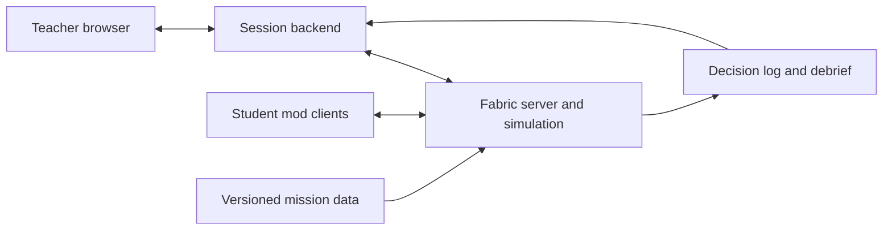

# Nimbus Nova: project plan

Version: November 14, 2026. Working plan for a five-person team.

Platform: Minecraft Java Edition 26.3, Fabric, Java 25, and a teacher web application.

Status: the first server-owned mission loop, role controls, HUD, and console are in development. The mod currently uses authored prototype rates; NASA observations are not integrated. Custom Mars terrain and items are a separate implementation batch. The teacher backend/admin panel belongs to another teammate and must not block local mod development. See [README.md](README.md) for usage, [TODO.md](TODO.md) for actual batch status, [JUDGE_REVIEW.md](JUDGE_REVIEW.md) for the provisional idea review, and [rules.md](rules.md) for competition requirements.

## 1. Product and learning goal

Nimbus Nova is an educational, cooperative Minecraft space mod. A teacher acts as Mission Control and sends student crews on Mars missions. Each student operates a different system, while the crew shares power, supplies, and responsibility for returning safely.

Students explore Mars, wear spacesuits, operate vehicles, talk to NPCs, and complete short equipment tasks. Missions use documented NASA observations to introduce environmental conditions and explain the engineering decisions behind survival. After a mission, the teacher and students review what the crew did and compare their experience with the relevant science or historical event.

The central mechanic is shared resources combined with different information. The power engineer knows the battery forecast. The life-support engineer knows oxygen demand. The pilot knows the return route. Students need to communicate before committing resources.

The initial audience is children ages 7–12, following the challenge brief. The teacher can adjust pace and hints. The team should test instructions with a young learner or an educator before claiming that the interface suits this age range.

Learning outcomes:

- Explain a choice where improving one system reduced another system's resources.
- Use an observation or forecast to change a mission plan.
- Communicate specialist information and agree on priorities.
- Explain the difference between a NASA measurement and a simplified game rule.
- Review a failed attempt and propose a better strategy.

The project covers life support, radiation protection, electricity, food production, and communication constraints. Individual missions can introduce these gradually rather than asking a new player to manage all of them at once.

## 2. Scope and delivery priorities

The full vision includes a teacher mission library, several crews, NPCs with branching dialogue, role tasks, Mars exploration, suits, rovers, and working spacecraft. Build the first complete classroom session before expanding the world.

| Area | Hackathon target | Follow-up release |
| --- | --- | --- |
| Class size | One teacher and one crew of up to five | Several isolated crews in one class |
| Hosting | Run one prepared Fabric server; use operator commands until the teammate's backend connects | Teacher session allocation, then capacity-limited server provisioning |
| Missions | One complete Mars dust-storm mission | Multiple playable missions and difficulty presets |
| Roles | Two active roles, power and life support; other participants can observe | Five useful specialist roles, rotation, combined roles for small groups |
| NPCs | One short state-aware guide after the core loop works | Mission specialist, maintenance robot, and mission-specific branching dialogue |
| Minigames | One physical task with a visible equipment/resource effect | Three reusable task types, cooperative puzzles, accessibility variants |
| Mars | One authored map with habitat and nearby expedition site | Larger regions and additional sites |
| Suits | Original equipment assets and a clear prototype boundary | Functional suit oxygen, airlock checks, outdoor safety, and repairs |
| Vehicles | Authored landing/vehicle areas; rover only after the resource lesson is complete | Controllable rover, then bounded shuttle flight, docking, and inter-location travel |
| Spacecraft presentation | Static or scripted arrival, labeled according to actual behavior | Interactive launch, flight, and landing |
| NASA evidence | One curated, attributed historical scenario | More observations and optional refreshed scenarios |
| Teacher report | Decision timeline and mission outcome | Cross-attempt comparison and additional lesson material |

The minimum judged demonstration must show one source-backed environmental change, two students sharing information, a consequential equipment task, an outcome, and an understandable debrief. Original map art and items support that experience. Extra NPCs, additional puzzle engines, full suits, and vehicles follow once this complete path works. Preserve them in the roadmap, but do not make all of them prerequisites for a valid first lesson.

The strict review identified scope and missing evidence as the largest scoring risks. Its provisional 13/25 applies to the idea and described evidence, not an official score or an evaluation of a finished build. The changes in this plan narrow the first demonstration and require a learning check and a traceable science transformation before claiming classroom impact or scientific validity.

## 3. Teacher and student journey

### Before class

The teacher checks that devices have Minecraft Java Edition, Fabric, the compatible mod, and access to the server. Provide exact version instructions and an installation checklist. A session code simplifies joining after installation; it cannot remove the game ownership or installation requirements.

### Teacher setup

1. Open the teacher application and authenticate.
2. Select a mission and inspect its learning objective, duration, required roles, and NASA sources.
3. Create a class session. The first version reserves the prepared server and resets the mission world.
4. Display the joining code and roster.
5. Assign roles or shuffle them. Combine roles when fewer than five students join.
6. Confirm readiness and start the briefing.

The first release can use a configured teacher account. Student accounts, public teacher registration, and password recovery are later work unless the chosen authentication service supplies them.

### Student entry

Students choose a display nickname, enter the session code in the mod's joining screen, and connect to the approved server. Minecraft player identity links each student to their session slot. After a disconnect, the same player can reclaim that slot while the session remains active.

The lobby shows the crew, assigned role, and readiness state. Students can meet the mission NPC and practice one task before mission time starts.

### During the mission

The teacher watches the roster, crew resources, objectives, warnings, and recent decisions. They can pause/resume, send a hint, reassign a role, remove a player, and end the mission with a recorded reason. The teacher's pause stops mission timers and resource simulation together.

Students explore, inspect equipment, discuss priorities, and perform tasks. The server advances the scenario and records consequences. Optional events triggered by the teacher must appear as teacher interventions in the report.

### After the mission

Students see the outcome, important decisions, historical context, and a short reflection prompt. The teacher can review the report, restart with fresh state, and rotate roles. A disconnected browser should reconnect to the existing session rather than create another one.

## 4. Crew roles and information

| Role | Specialist information | Physical tasks | Shared trade-off |
| --- | --- | --- | --- |
| Power engineer | Generation, consumption, battery forecast | Connect circuits, inspect solar equipment, allocate power | Reserve capacity versus equipment availability |
| Life-support engineer | Oxygen reserve, production, habitat conditions | Diagnose a leak, service oxygen equipment, prepare airlocks | Immediate safety versus electricity and spare parts |
| Food and water specialist | Water reserve, greenhouse demand, growth progress | Route water, inspect pumps, choose lighting allocation | Future supplies versus today's power and water |
| Safety and maintenance engineer | Exposure warnings, shelter readiness, damaged equipment | Inspect shelter, repair machinery, prepare safe routes | Protection versus materials, time, and outdoor work |
| Expedition commander / pilot | Route, expedition objectives, vehicle range, crew readiness | Drive, navigate, collect samples, coordinate return | Science progress versus return reserves and exposure |

Detailed controls belong to the assigned role. Everyone sees critical crew warnings and a small shared status display. Students can inspect another station's purpose without gaining its control permissions.

Use role assignment to distribute responsibility, not to prevent help. Later cooperative tasks can require a specialist to authorize equipment while a teammate performs a nearby action. For the first build, each role must remain useful without requiring five simultaneous button presses.

Text communication and in-person conversation are sufficient initially. Integrated voice chat adds installation and moderation work; add it only after classroom testing establishes a need. Distinguish immediate crew messages from delayed Earth Mission Control messages in later missions.

## 5. Mission structure and simulation

Use this sequence: lobby, briefing, practice, active mission, outcome, debrief. Store the current phase on the server and define which actions are legal in each phase.

The current prototype lasts four minutes, with an authored dust event from 01:15 to 03:15. Full success requires keeping battery and oxygen above zero until 04:00 and operating research for at least 90 seconds. Survival without sufficient research earns partial success. This prevents “turn research off forever” from becoming the dominant full-success strategy. These timing and resource values are game balance, not NASA measurements.

A later classroom mission may last 10–15 minutes, excluding discussion; validate duration through playtesting. Simulated Martian time may run faster than classroom time. Display the scale and explain it in the debrief.

Track only resources that create decisions in the selected mission:

- Battery energy, generation, and power demand.
- Habitat and suit oxygen reserves.
- Water and available food, where relevant.
- Spare parts and equipment condition.
- Exposure warnings and time spent outside, when the mission requires them.

Use a fixed server simulation interval independent of client frame rate. Express rates and quantities consistently: energy stored differs from power consumed. Clearly label normalized game units wherever the model does not use physical units.

Equipment needs an operating state and a power demand. Generation, demand, and elapsed simulated time determine battery changes. Oxygen production and consumption determine reserve changes. Clamp quantities to valid ranges and define the consequence of a depleted reserve. Share the same simulation code across mission variants.

Shelter and suit shielding are passive protection. Their costs can include mass, construction materials, restricted mobility, and time spent reaching shelter. Electricity powers shelter equipment and life support; do not suggest that a shielding wall needs continuous electricity to block radiation.

Food production needs a longer simulated timescale than a short repair. Short missions can focus on protecting stored supplies or planning greenhouse allocation. Show accelerated growth as an explicit teaching simplification.

Define success, partial success, and mission abort. Students should receive a warning and a recovery opportunity before most failures. A failed mission can end with a rescue/abort screen and an explanation rather than a graphic death sequence.

## 6. NPCs and dialogue

NPCs should give students reasons to explore, explain unfamiliar equipment, and react to mission decisions. Keep initial dialogue authored and tied to mission state so science explanations remain reviewable and sessions work without an external language model.

| Character | Purpose | Initial interactions |
| --- | --- | --- |
| Mission specialist | Briefing, objectives, historical context | Introduce roles, explain the mission, answer short questions, lead debrief |
| Maintenance robot | Equipment guidance and local hints | Explain a console, identify a fault, offer a staged hint, acknowledge a completed repair |
| Earth Mission Control contact | Later communication-delay lessons | Send delayed guidance and explain why the crew must act independently |

Use original character names, artwork, and writing. NPCs can be fictional members of the expedition. Avoid presenting fictional dialogue as a quotation from a NASA scientist or astronaut.

Each conversation node needs an ID, speaker, short text, optional player choices, conditions for appearing, and any permitted mission effect. Initial effects can reveal a tutorial, mark a briefing read, or open a task. The server checks conditions before applying an effect.

Dialogue behavior:

- Keep the first message to a few readable lines, with an optional explanation button.
- Offer choices such as “Explain my role,” “Show my objective,” and “I need a hint.”
- Change responses when a warning begins, a repair finishes, or the mission ends.
- Preserve the student's progress if they close and reopen a conversation.
- Allow replaying instructions and skipping dialogue already read.
- Use visible text even if optional voice or sound is added later.
- Give hints in stages: identify the relevant system, point toward the action, then offer explicit help.

Example dialogue, written for this project:

> Maintenance robot: “Dust is reducing the power from our panels. Ask the power engineer how much battery time remains before you leave the habitat.”
>
> Student choices: “Show me the power station,” “Why does dust reduce power?”, “Return to my task.”

The explanation can describe less sunlight reaching the panels and link to the mission's source card. It must not promise that cleaning a panel will remove an atmospheric dust storm.

NPC dialogue should support crew decisions. A hint can explain the consequences of switching off a system without choosing the crew's entire strategy for them.

## 7. Among Us-style task minigames

Use short, tactile equipment interactions inspired by the readability and pacing of task games. Create original interfaces, sounds, artwork, and puzzle rules. The educational game remains cooperative; deception, impostors, and voting players out are outside the planned classroom loop.

A minigame is a way to perform an engineering action. The important decision is whether the crew should spend resources on that action now. Puzzle completion must cause a visible change in the mission.

| Task | Interaction | Role | Mission effect and cost |
| --- | --- | --- | --- |
| Restore a circuit | Connect labeled endpoints through valid paths | Power | Restores one device; consumes a part and enables its ongoing power draw |
| Service oxygen equipment | Put a diagnostic/checklist sequence in order | Life support | Restores production capacity; requires maintenance time and supplies |
| Route water | Rotate pipe pieces to connect the selected destination | Food/water | Sends limited water to storage, recycling, or greenhouse |
| Diagnose a damaged component | Compare a reading with a labeled reference and select a repair | Safety/maintenance | Spends a matching part to restore equipment condition |
| Prepare the rover | Complete a route and return-reserve checklist | Pilot | Authorizes departure when the plan meets minimum safety requirements |
| Handle a science sample | Match sample identifiers to containers | Expedition | Preserves collected research; uses cargo capacity and time |
| Inspect a shelter | Find missing supplies and place them in marked storage | Safety/maintenance | Improves preparedness through supplies and crew effort |

First implement one task type and connect it to a server-validated equipment consequence. A station toggle currently establishes that consequence; it is not yet a completed task minigame. Then expand to connection/routing, ordered checklist, and inspection/matching as reusable task types. Reuse content so five roles can participate without building five unrelated UI systems.

Task rules:

- Aim for roughly 15–45 seconds per task, then test with students.
- Explain both the immediate goal and the equipment consequence before starting.
- Use labels and shapes alongside color. Support readable UI scaling and forgiving input targets.
- Let the teacher disable strict timing. Avoid precision clicking as a requirement for learning.
- Show recoverable feedback for a wrong step. Do not silently consume scarce parts on every mistaken click.
- Separate “task complete” from “mission objective complete.” A repaired generator still needs an appropriate operating allocation.
- Prevent duplicated rewards, simultaneous conflicting edits, and replayed completion messages.
- Release or reset a task when its player disconnects. Record resource costs exactly once at the defined commit point.

The server owns the task instance, valid actions, completion state, and resource effects. A client cannot grant a repair by sending only a success flag. Check the player's role, distance, mission phase, task state, and available supplies before committing an equipment change.

## 8. Mars world, suits, and vehicles

### First map

Build one authored Mars site with a habitat, greenhouse, power area, equipment workshop, shelter, rover bay, landing zone, and a nearby sampling destination. Use paths, signs, and recognizable equipment silhouettes to help young players navigate.

Use a controlled mission area or dimension with a prepared world. Full procedural planet generation can wait. Terrain can draw from a named Mars location, but label invented geography and stylized scale. Do not claim a scientifically accurate reconstruction without supporting data.

The environment should communicate mission state through visibility, equipment activity, readable warnings, and sound cues with text equivalents. Provide reduced flashing and a clear way to distinguish warning severity.

### Spacesuits

Students equip a suit before outdoor activity. Track suit oxygen and show an understandable return warning. A working airlock connects the habitat and surface. Define protected interior areas explicitly rather than treating any player-built dirt box as a pressurized habitat.

Begin with an identifiable suit model/texture and a simple safety mechanic. Pressure simulation, custom movement physics, and detailed thermal models are later work. Any simplified hazards need an explanation in the mission guide.

### Rover

The first rover needs boarding, steering, stopping, a limited operating reserve, and dismounting. The server owns movement constraints and reserves. Give the pilot a meaningful route choice and a reason to coordinate with power and safety specialists.

Keep routes short enough for the classroom session. Provide a recovery action for a stuck vehicle and define safe behavior if the driver disconnects.

### Working spacecraft

The full release should include a pilotable shuttle with crew seats, boarding checks, a shared departure checklist, limited fuel/energy, controlled flight, and landing zones. Connect preparation tasks to flight: a crew member restores power, another checks supplies, and the pilot confirms readiness.

Start with flight inside a bounded mission area and travel between prepared locations. Expand toward docking and orbital/Mars transitions after that loop works. Display loading/travel sequences honestly; a scripted transition is a different milestone from controllable flight.

The hackathon arrival/extraction may use a scripted shuttle sequence. The pilot role still gets controllable rover gameplay. Do not advertise the first build as containing free spacecraft flight until it does.

## 9. First mission: The Darkening Sky

Learning objective: adapt an expedition and power budget when solar generation declines.

Historical basis: NASA's Opportunity rover experienced a Mars-wide dust storm in 2018. Its final communication arrived on June 10, 2018, and NASA announced the mission's end in February 2019 after recovery attempts. The student habitat and crew are fictional. [NASA/JPL account](https://www.jpl.nasa.gov/news/nasas-opportunity-rover-mission-on-mars-comes-to-end/)

| Stage | Student experience | Required integration |
| --- | --- | --- |
| Arrival and briefing | Meet the NPC, receive roles, inspect suits | Lobby, dialogue, roles, mission start |
| Establish the habitat | Bring essential equipment online through short tasks | Role permissions, task validation, shared resources |
| Explore | Prepare the rover and collect a sample | Vehicle, route, expedition objective |
| Forecast update | NPC and instruments warn of reduced sunlight | Scenario timeline, source card, warning UI |
| Dust event | Generation falls and the crew revises allocations | Power model, consequences, communication |
| Return and stabilize | Recall expedition, maintain essentials, preserve reserves | Shared decision, return condition, outcome |
| Debrief | Review decisions and learn about Opportunity | Event log, NASA context, teacher report |

Specify at least two viable strategies during balancing. For example, a cautious crew can return early with less research, while another crew can collect more research after preserving sufficient reserves. Do not make a mandatory scripted failure look like an avoidable player mistake.

Use food and water as reserve/planning concerns in this short mission. Introduce substantial greenhouse growth in a longer mission. Radiation is a separate future scenario unless its data and learning purpose justify adding it here.

## 10. Mission library roadmap

| Mission | Main decision | Candidate task/NPC content | Evidence work still needed |
| --- | --- | --- | --- |
| The Darkening Sky | Exploration and equipment demand versus falling solar supply | Power routing, rover preparation, maintenance hints | Select a usable documented dust/solar record and validate the transformation |
| Shelter Before the Event | Complete outdoor work or move crew to protection | Shelter inspection, suit checks, safety briefing | Select Mars-relevant radiation observations and define justified simplifications |
| The Long Night | Heating and life support versus limited reserves | Checklist, battery allocation, route recall | Select a named site's environmental observations |
| Greenhouse Emergency | Water/food planning versus immediate energy demand | Pipe routing, crop inspection, scientist dialogue | Choose relevant plant research and a defensible accelerated model |
| Return Window | Cargo and research versus safe departure | Cooperative shuttle checklist, repairs, piloting | Identify sources for the specific mission constraints |

The teacher chooses among missions once each is implemented. Show planned missions as unavailable previews, with no start button implying finished content. Later presets can adjust hints, complexity, and event pace while retaining the same underlying science explanation.

## 11. NASA evidence and scenario data

Start with archived, curated data packaged alongside the scenario. An internet outage should not interrupt a lesson. A live-data connection is optional later work and must retain a labeled fallback.

Each source record should identify the agency/mission, instrument or report, URL, observation dates, location, units, use terms, retrieval date, and processing notes. Store the source file or a reproducible extract when redistribution permits it.

Separate three layers in both content and UI:

1. Observation: the measurement or historical finding that the source supports.
2. Simulation: the documented transformation that changes a game system.
3. Fiction: the student crew, habitat, equipment capacities, and story.

The first science deliverable is finding and extracting usable evidence for the dust scenario. The historical article establishes context; it does not by itself provide a complete calibrated time series. If only a documented event sequence is used, call it a historically grounded scenario and explain the invented balance values.

Do not combine measurements from different dates or landing sites and call them one observed Martian day. Document resampling, missing values, and any time compression. Missing evidence should produce an explicit limitation or a labeled authored event, not a fabricated measurement.

Candidate references:

- [Official challenge](https://www.spaceappschallenge.org/2026/challenges/junior-astronaut-mission-trainer/): educational objectives and suggested resources.
- [Opportunity mission account](https://www.jpl.nasa.gov/news/nasas-opportunity-rover-mission-on-mars-comes-to-end/): historical dust-storm context.
- [Curiosity radiation measurements](https://science.nasa.gov/resource/radiation-measurements-on-mars/): Mars surface radiation context for a later mission.
- [NASA OSDR](https://osdr.nasa.gov/): candidate space biology research for food/health lessons; exact studies remain to be selected.
- [Mars Trek](https://trek.nasa.gov/mars/): candidate terrain/context resources; exact products and reuse terms remain to be selected.

Keep source cards available inside the mission and include references in the teacher report. Do not equate an Earth-directed space-weather alert with a measured Mars surface dose. Radiation indicators in an educational simulation must not imply medical or operational safety guidance.

## 12. Teacher application

| Screen | Required behavior |
| --- | --- |
| Mission library | Show objective, duration target, crew size, readiness, and evidence sources |
| Create session | Allocate the prepared server, select mission, display joining code and status |
| Lobby | Show players, connection/readiness, role assignment, remove/reassign controls |
| Live mission | Show crew resources, phase, objectives, warnings, recent actions, pause and hints |
| Debrief | Show outcome, resource history, decisions, interventions, sources, reflection prompts |

Use an existing UI system if one is chosen during implementation. The teacher needs clear controls and readable information more than decorative telemetry. Show pending operations and useful errors when the server is unavailable or the session is full.

For the first build, reset and reserve one server per session, with a clear occupied state. Do not let a second teacher reset an active class. Later hosting can allocate isolated processes/worlds for multiple crews and enforce capacity, idle shutdown, and cleanup rules.

## 13. Technical architecture and contracts

### Ownership

- Fabric server: mission state, roles, resource calculations, tasks, NPC conditions, equipment effects, vehicle rules, outcomes, and event history.
- Mod client: joining UI, HUD, task screens, dialogue presentation, rendering, and input.
- Backend: teacher identity, session ownership, joining-code resolution, approved server allocation, command relay, and report access.
- Website: teacher presentation and control requests. It does not run a second copy of the resource simulation.

Choose the web stack before implementation based on what the team can already ship. A small frontend and one backend service are sufficient. Avoid adding microservices or an orchestration platform for a single prepared server.

### Integration contract

Agree on a minimal shared shape before the team splits work:

| Data | Minimum fields |
| --- | --- |
| Session | ID, teacher owner, code expiry, mission ID/version, phase, server status |
| Player | Minecraft identity, display name, connection, role, readiness |
| Mission snapshot | Revision, simulated time, phase, resources, objectives, warnings |
| Task instance | ID, type, equipment ID, permitted role, state, completion/cost status |
| Teacher command | Command ID, session ID, action, parameters, result |
| Decision event | Sequence, simulated time, actor/role, action, costs, resulting changes |
| Scenario | ID/version, briefing, initial conditions, events, tasks, outcomes, sources |

The teacher website gets a full snapshot when it connects, followed by updates or periodic refreshes. Reconnect must restore the latest state. Command IDs let the backend/server reject accidental duplicate operations. Log records need enough information to explain an outcome without recording private student conversations.

Use an authenticated server/backend connection; keep infrastructure secrets out of the game client. A browser request cannot execute arbitrary shell commands or choose arbitrary server binaries. Mod task requests must pass server-side validation even when the joining code is valid.

## 14. Session lifecycle, recovery, and classroom safety

- Generate a short-lived joining code and rate-limit guesses. Treat the code as a way to find a session, not as permission to use teacher controls.
- Require teacher authorization for start, pause, kick, role changes, reset, and reports.
- Keep Minecraft's normal identity checks enabled for a public hosted server.
- Lock teacher ownership of a session and prevent cross-session data/control access.
- On student disconnect, preserve reserves and role state, release unfinished tasks, stop uncontrolled vehicle motion, and let the teacher reassign responsibilities.
- If an NPC dialogue or task screen closes, leave the mission in a defined, recoverable state.
- If the backend disconnects, preserve the game session and show the teacher a reconnect state. Do not reset the world.
- For the hackathon, a Minecraft server crash may require restarting the mission; disclose that limit. Persistent recovery is a later milestone.
- Use nicknames and minimal session records. Do not require student email addresses or record chat/voice for the report.
- Define temporary data retention and deletion behavior before a public classroom release. Do not promise a compliant school deployment until its actual configuration has been reviewed.

World reset must only affect the dedicated session world. Keep a separate clean map template and never reset an arbitrary path supplied by a browser. Report a failed reset and block the next start instead of using partially reset state.

## 15. Debrief and teacher report

The report should help a teacher discuss cause and effect. Include:

- Mission ID/version, scenario dates/site, crew roles, and outcome.
- Resource history at meaningful intervals and major decisions.
- A few consequence statements, such as “Reducing greenhouse lighting preserved energy but delayed production.”
- Completed tasks, abandoned tasks, and teacher interventions where relevant.
- NASA source cards and the model's main simplifications.
- Reflection prompts: “Which resource limited you?”, “What information changed your plan?”, and “What would you do differently?”

Distinguish measured events from rule-based explanations. The server can report that a switch reduced demand; it should not invent an explanation of a child's motives. Do not grade teamwork from message count or use an opaque automated score.

Start with safety, objective completion, and remaining reserves as separate outcomes. Let the teacher interpret them. Later compare a crew's attempts using the same scenario, with role rotation and the amount of help visible.

## 16. Five-person work split

Assignments describe ownership, not restrictions on collaboration. Pick names as the team agrees.

| Owner | Primary work | First deliverable | Depends on |
| --- | --- | --- | --- |
| 1: server/simulation | State, resources, roles, outcomes, action validation | One action changes a shared resource and creates a decision event | Shared mission contract |
| 2: mod client | Joining, HUD, dialogue, minigame screens | Two clients see the same resource update and different role details | Server packets/state |
| 3: teacher platform | Session backend, dashboard, roster, controls, report | Teacher starts/pauses a prepared session | Server bridge and teacher auth |
| 4: world/gameplay | Map, equipment, NPC placement, suits, rover | Small traversable base with interactable stations | Equipment/task identifiers |
| 5: science/learning | Scenario evidence, dialogue scripts, learning flow, debrief, demo | Source register and playable mission sequence | Selected scenario and working event log |

NPC dialogue content belongs with owner 5; rendering/UI belongs with owner 2; conditions and effects belong with owner 1. Owner 4 places the NPCs and equipment. This split prevents a standalone NPC system that never reaches the mission.

Owner 3 consumes the agreed report format rather than recreating mission logic. Owner 5 coordinates learner testing and the submission, with help from the rest of the team. Keep at least one backup person able to build and run the integrated project.

## 17. Implementation order and milestone checks

### Milestone A: one connected action

Run the server and two clients without waiting for the external teacher backend. Use operator commands for start/pause/reset, assign the power and life-support roles, perform one equipment action, and show its shared resource consequence on both clients. Pause must freeze mission time, reserves, and research progress.

Done when the mod path works together. Record the snapshot and lifecycle contract for the teammate implementing the backend; connect the teacher roster/page as a later integration check. Mock data may support early UI work but does not satisfy the multiplayer check.

### Milestone B: one NPC and one task

An NPC explains an objective, opens a valid task, and changes dialogue after completion. The server applies one resource/equipment change and records it. Reopening the task cannot apply the reward again.

Done when students can complete the interaction and explain its effect without a developer operating it for them.

### Milestone C: the Mars crew

Add the authored base, original item textures, role-specific station interactions, and a clear route to the expedition site. Confirm that a reconnect and permitted role reassignment do not strand the mission. Label decorative vehicle/suit assets according to their actual functionality.

Done for the first map batch when students can enter the map safely, navigate the important stations, and perform the resource interaction without a developer moving them around. Functional suit safety, airlocks, and rover traversal are the next gameplay expansion.

### Milestone D: the dust scenario

Connect selected evidence to a visible environmental/resource change. Add warnings, at least two viable approaches, mission outcomes, and a debrief with sources. Complete teacher start/pause/end behavior.

Done when a complete mission produces an understandable report and students can explain the core trade-off.

### Milestone E: hackathon handoff

Run a complete integrated rehearsal, fix blocking problems, prepare setup instructions, and produce the required public demo and source references. Verify the judging links without a signed-in session. Use [rules.md](rules.md) for the applicable submission limits and deadline.

If time runs short, reduce map size, optional art, extra task variants, and cinematic length. Preserve two active roles, one meaningful task, a shared resource trade-off, source attribution, and debrief. Use the operator-controlled mod flow until the external teacher platform is ready. Do not claim that a local command demonstration proves working teacher hosting.

### After the hackathon

Finish additional playable missions, controllable shuttle flight, multiple independent crews, hosting automation, and stronger recovery. Validate each addition with a classroom-sized test before expanding again.

## 18. Verification and acceptance

Add focused tests when implementing the corresponding logic:

| Area | Claim-relevant check |
| --- | --- |
| Simulation | Known generation/demand over known elapsed time gives expected reserves; pause changes nothing |
| Task protocol | Wrong role, distance, supplies, and duplicate completion cannot grant effects |
| Session control | One teacher cannot view or control another session; join code cannot call teacher actions |
| Data | Units, missing values, scenario version, and source attribution remain valid through import |
| Recovery | Disconnect/rejoin restores role; a stuck task or lost driver has a recovery path |
| End-to-end | Teacher creates session; students join; NPC/task changes resources; event causes a decision; report matches the outcome |

Manually check readable instructions, input size, text scaling, color-independent cues, hint behavior, and a slower student's ability to finish. Test on the actual machines available to the team; agree on performance targets after measuring them.

### Small learning check

Before the mission and again after the debrief, ask the same two questions:

1. “Why can't every system stay on at once?”
2. “What information would make you change the crew's plan?”

Ask an educator or a small number of learners to explain their answers in their own words. Record anonymous notes about whether they mention limited power, competing objectives, and changing conditions. Also note whether they needed help with installation or controls. Keep names, voices, and minors' likenesses out of public demo material.

Use the result as a small usability/learning observation, with participant count and limitations. Do not claim broad educational improvement or age suitability from a single successful playthrough. A student who can connect the falling solar supply to a deliberate change in research or oxygen use provides stronger evidence than a completion score alone.

### Science evidence gate

Before marking NASA integration complete, identify an exact observation or documented condition, its dates and site, and the transformation into a visible game effect. Put this chain in the mission, source register, and demonstration: source observation → environmental change → crew decision → resource consequence → explanation. A historical article can support context; it does not establish a calibrated measurement series. Keep the authored prototype label until that evidence exists.

Hackathon acceptance checklist:

- [ ] Minecraft 26.3 / Java 25 build and multiplayer startup work.
- [ ] Two players join the prepared server and receive the two active roles.
- [ ] Operator commands start, pause, resume, reset, and abort the mission correctly.
- [ ] Power and life-support roles each control a meaningful resource decision.
- [ ] One physical task operates through server-validated actions; NPC guidance supports its consequences when included.
- [ ] Students can safely enter and navigate the authored Mars area; map/item descriptions match delivered functionality.
- [ ] Teacher session codes, roster, and admin controls work once the teammate's platform is integrated; this is separate from the mod-only milestone.
- [ ] A documented NASA-based scenario changes mission decisions.
- [ ] The mission has clear success, partial success, or abort outcomes.
- [ ] Students receive a debrief tied to actual actions; the teacher platform consumes the same report when available.
- [ ] A small learner/educator test records what participants understood before and after, without overstating its reach.
- [ ] Instructions, dialogue, website, and submission materials are in English.
- [ ] Credits, licenses, AI disclosures, privacy checks, and public judging links are ready.

## 19. Risks and decisions to resolve

| Risk or decision | Proposed handling |
| --- | --- |
| Minecraft dependency eligibility | Ask the registered Local Lead; MIT mod code does not settle the proprietary host requirement |
| Unknown registered event/local pitch deadline | Confirm against the team's accepted event and current rules |
| More features than five people can integrate | Finish milestones in order; retain expanded scope as a roadmap |
| No usable dataset selected yet | Assign evidence selection first; distinguish historical accounts from actual measurements |
| Student installation and school network limits | Test setup and joining on representative devices before class |
| NPCs become exposition walls | Short state-aware dialogue, optional details, visible objectives |
| Minigames become unrelated busywork | Require an equipment effect and a resource decision for each task |
| One student controls all decisions | Enforce role permissions, distribute tasks, rotate roles between attempts |
| Arbitrary resource balancing teaches wrong science | Document transformation rules, units, and fictional capacities |
| Vehicle/space scope delays a playable lesson | Ship rover plus scripted arrival first; implement bounded shuttle flight next |

Implementation follows the batches in [TODO.md](TODO.md). Complete and verify the core mod loop first, integrate the original Mars map and items next, then finish the science/learning demonstration before adding more systems. The five-role, NPC, minigame, and spacecraft roadmap remains intact.
