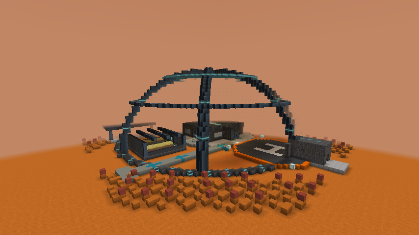
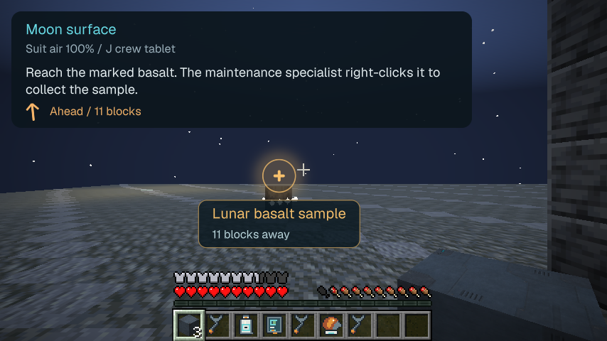
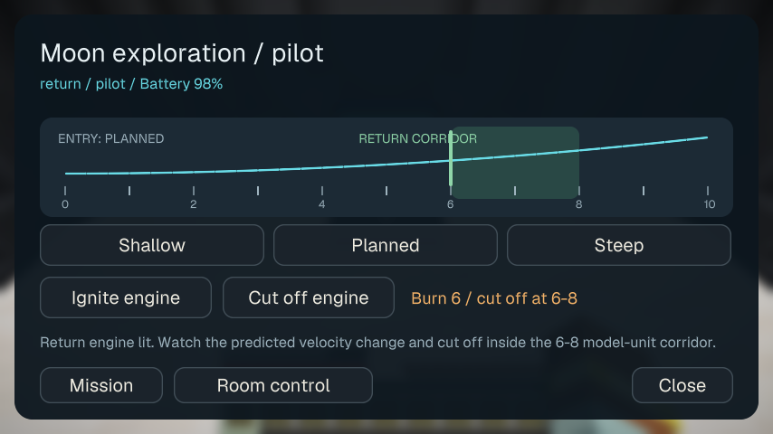
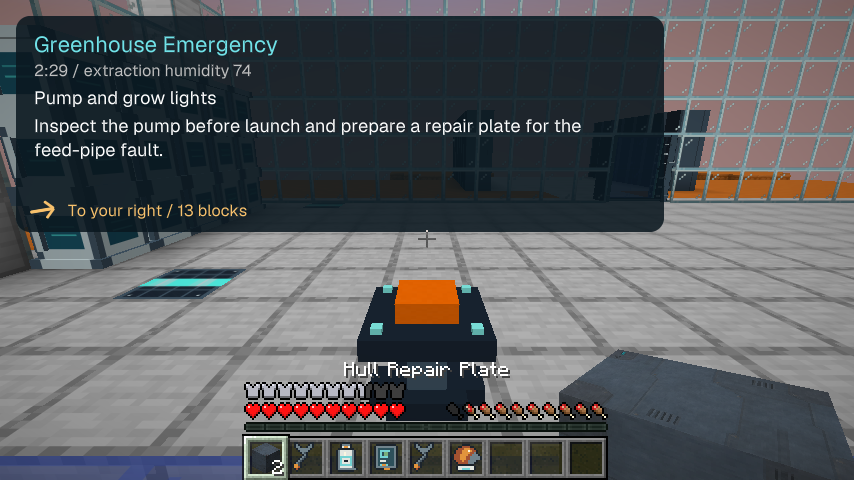

<h1 align="center">🛰️ Nimbus Nova</h1>

<p align="center"><strong>A cooperative astronaut mission trainer inside Minecraft</strong></p>

<p align="center">
  <a href="https://github.com/KawaseDev/Nimbus-Nova-MC/releases/latest/download/NimbusNova.mrpack"><strong>⬇ Download the modpack</strong></a>
  · <a href="https://github.com/KawaseDev/Nimbus-Nova-MC/releases/latest">Release files</a>
  · <a href="PLAYER_GUIDE.md">Crew guide</a>
  · <a href="TEACHER_GUIDE.md">Teacher guide</a>
</p>

<p align="center">Minecraft Java Edition 26.3 · Fabric · Java 25 · Six playable missions</p>

<p align="center">
  
  <br><em>Aster Outpost, captured in Minecraft</em>
</p>

Dust cuts power at a Mars outpost. The crew can keep oxygen running or use that energy to finish a science task, and every specialist sees different readings. Students have to compare what they know, decide together, and carry out the plan at working equipment in the world.

Nimbus Nova is an independent student project for the 2026 NASA Space Apps Challenge. [Build a Junior Astronaut Mission Trainer](https://www.spaceappschallenge.org/2026/challenges/junior-astronaut-mission-trainer/)

## 🚀 Start playing

1. Import [NimbusNova.mrpack](https://github.com/KawaseDev/Nimbus-Nova-MC/releases/latest/download/NimbusNova.mrpack) in a Modrinth-compatible launcher and use **Java 25**. You need Minecraft Java Edition **26.3**.
2. For a solo demo, create a world with commands enabled and open **`/nimbus`**. Select a mission and pick a role in the crew tablet. In a class, choose **Join session** on the title screen and enter the code and address from your teacher.
3. Press **J** for the crew tablet. Follow the amber waypoint and right-click the marked equipment. Complete the preparation checks before Mission Control starts the timer.

The release also offers a standalone mod JAR for manual Fabric setups. Install **Fabric Loader 0.20.1** and **Fabric API 0.165.2+26.3** on clients and the server. Use the same Nimbus Nova build on both. [Release files](https://github.com/KawaseDev/Nimbus-Nova-MC/releases/latest)

## 🪐 Mission library

| Mission | What your crew has to decide |
| --- | --- |
| 🔴 **The Darkening Sky** | Keep air flowing and finish research as a Martian dust storm cuts solar output. |
| 🌕 **Moon Expedition** | Verify the approach, manage descent speed, collect a lunar sample, and return the crew. |
| 🛰️ **Return Window** | Restore a ship’s power, patch a hull breach, rebuild the CO₂ filter, and time the return burn. |
| 🛡️ **Shelter Before the Event** | Build shielding and decide when a live radiation reading is worth leaving cover. |
| 🔋 **The Long Night** | Repair a failed junction and share limited power between heat, air, the lab, and the rescue beacon. |
| 🌱 **Greenhouse Emergency** | Patch a feed pipe and balance irrigation, root aeration, lights, and cabin humidity. |

| Lunar exploration | Flight instruments | Greenhouse Emergency |
| --- | --- | --- |
|  |  |  |
| Follow the lunar sample waypoint. | Compare entry predictions before burning fuel. | Find the feed system and keep crops alive. |

## 🎛️ A mission from briefing to debrief


The teacher panel runs locally. It hosts the server, issues a join code, shows the roster and student launch requests, controls the mission clock, and downloads saved debriefs. A local operator can run the same missions through `/nimbus` in singleplayer. [Teacher setup](docs/REFERENCE.md#teacher-panel) · [Host guide](TEACHER_GUIDE.md)

## 📡 From rover readings to game decisions

**The Darkening Sky** uses two real Opportunity dust storms to set how much solar energy remains at each storm’s peak. In the game, this changes the power available to oxygen production and research. The crew can pause one load, use a finite reserve cell, or risk waiting for more generation.


The bars divide reported storm-day output by the corresponding pre-storm reference. Game time, resource capacities, and other training values are authored. The credits record the inputs and how each source was used. [NASA JPL’s 2007 report](https://www.jpl.nasa.gov/news/nasa-mars-rovers-braving-severe-dust-storms/) · [NASA’s 2018 report](https://science.nasa.gov/resource/on-mars-light-is-energy/) · [2018 reference output](https://www.planetary.org/articles/06-mer-update-opportunity-dust-storm-sleep) · [Sources and AI assistance](CREDITS.md)

## 🛠️ Build and explore

With JDK 25 installed, run these commands from the repository root. On Windows, use `gradlew.bat`.

```sh
./gradlew build
./gradlew runClient
```

`build` runs the simulation and headless Minecraft server checks. For the rendered gameplay suite, run `./gradlew runClientGameTest` on a machine with a graphical session.

- 📖 [Technical reference](docs/REFERENCE.md) for setup, commands, equipment, and mission behavior.
- 🎙️ [Pitch outline and demo screenshots](presentation/pitch.md) for the presentation.
- 🧾 [Competition requirements](rules.md) and [source register](CREDITS.md).

### Optional local terrain import

The public release uses the team’s authored Mars terrain. The project also supports a private, scaled preview of Mars elevation through MarsCraft. [Import instructions and source permissions](docs/REFERENCE.md#optional-local-terrain-import)

Original project code is available under the [MIT License](LICENSE). [Asset and dependency credits](CREDITS.md)
